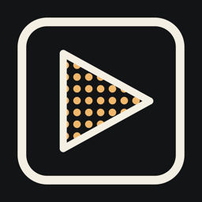

# Read with Binge

[Binge](https://bingecomics.com/komga) is a third-party reader for iPhone and iPad. It connects directly to Komga through the REST API with an API key, shows your libraries, collections and read lists as Komga has them, and syncs read progress both ways, to the page.

## Install and connect {#install}

You need iOS or iPadOS 17 or later, **Komga 1.20.0 or later**, and a server that your device can reach.

1. In the Komga web interface, open **Account settings** → **API keys** and create a key.
2. Download Binge from the [App Store](https://apps.apple.com/app/id6831703964).
3. Open **Settings** in Binge and, under **Server experience**, select **Komga**.
4. Choose **HTTP** or **HTTPS** and enter the **Server address**, such as `komga.example.com` or `192.168.1.20:25600`. Include the port and any reverse proxy base path if your server uses them.
5. Paste the key into **Komga API key** and tap **Connect**.
6. If the server is on your home network, allow **Local Network** access when iOS asks.

With **Remember connection** on, the address and the key are kept in the device's Keychain. The key is sent only to your server.

## Features {#features}

- Continue Reading and On Deck, as Komga computes them.
- Read progress syncs both ways through the Komga API. Marking a book or a whole series as read or unread is sent to the server too.
- Collections and read lists: browse them all, and create, edit and reorder them with an admin account.
- Downloads for offline reading: a book, a whole series or a read list. Progress made offline is sent once the server is reachable again.
- Comics and manga, PDF, and DRM-free EPUB books, with the EPUB position saved to Komga.
- No account, no ads and no analytics in the app.
- Connecting and browsing your library are free. Reading and downloading need a subscription (US$1.49 a month or US$14.99 a year, each with a one-month free trial) or a one-time purchase of Binge 1.x (US$34.99).

## Useful links {#links}

- [bingecomics.com](https://bingecomics.com) — What Binge looks like, in short recordings
- [Binge for Komga](https://bingecomics.com/komga) — Setup and troubleshooting
- [App Store](https://apps.apple.com/app/id6831703964) — Download Binge
- [Support](https://bingecomics.com/support) — Help and contact
