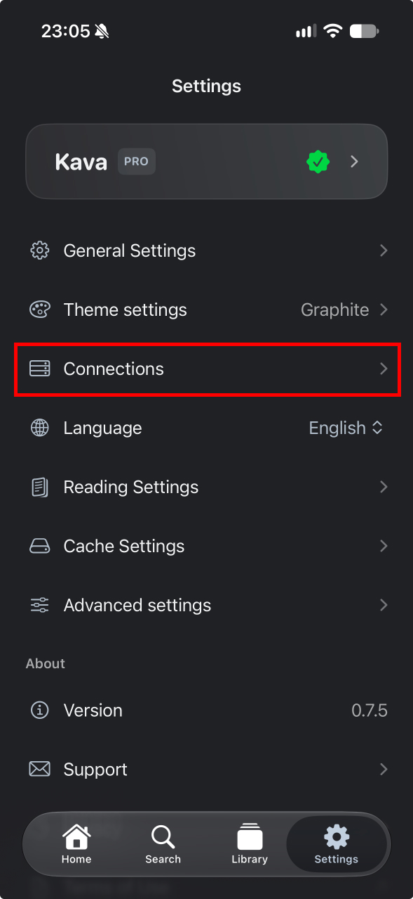
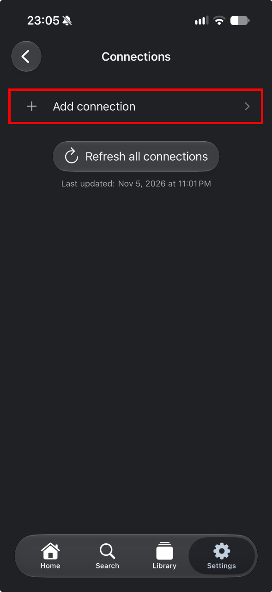
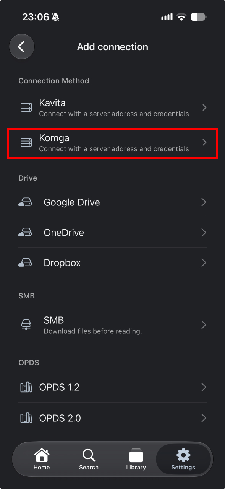
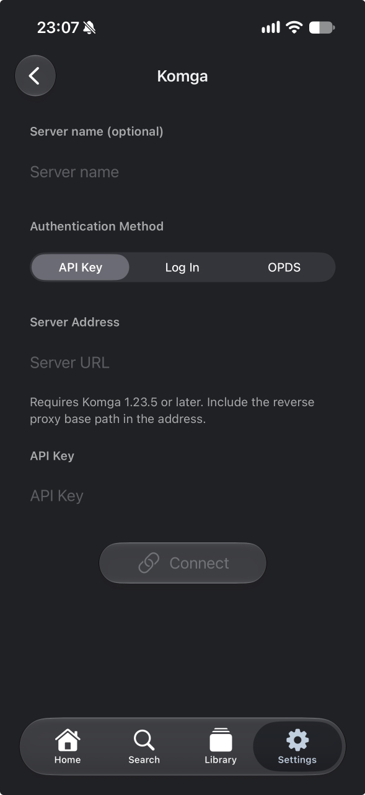

# Read with Kava

[Kava](https://apps.apple.com/us/app/kava-comic-reader/id6817441940) is a third-party comic and book reader for iPhone and iPad. It connects directly to Komga and uses your library metadata to build a home screen with cover rows, recommendations, and Continue Reading.

## Install and connect {#install}

You need iOS or iPadOS 18 or later and a Komga 1.23.5 or later server that your device can reach.

1. Download Kava from the [App Store](https://apps.apple.com/us/app/kava-comic-reader/id6817441940).
2. In **Settings**, tap **Connections**.
3. Tap **Add connection** and select **Komga**.
4. Enter the server URL, such as `https://komga.example.com`. Include the port and any reverse proxy base path if your server uses them.
5. Select **API Key** and paste a key from your Komga user settings, or select **Log In** and enter your Komga email address and password.
6. Tap **Connect**, then open **Library** to browse your Komga libraries.

  
  
  
  

## Browse and read {#features}

- Find comics through the Home tab, browse your Komga libraries by series, or search by title.
- Read with page turns or vertical scrolling and pick up where you left off with Continue Reading.
- One server connection and online reading are free. Kava Pro adds multiple connections and manual downloads for offline reading.

For help, see [Kava support](https://ckim.dev/kava/support/).
